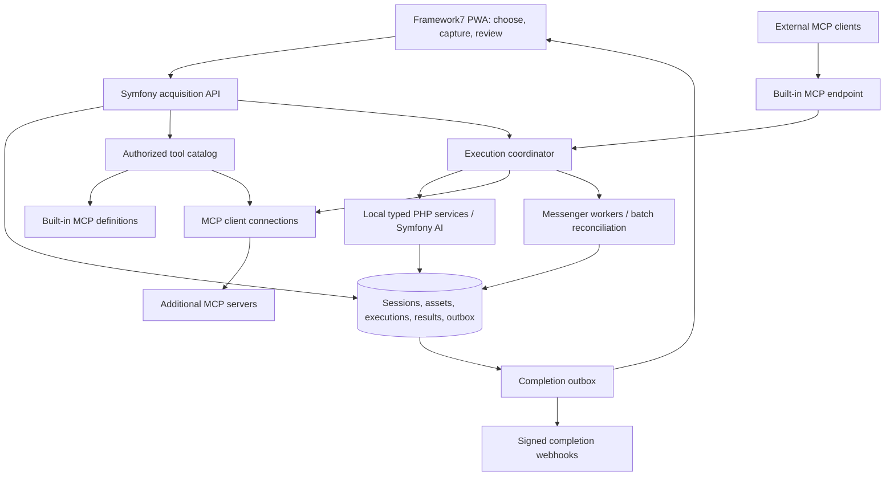
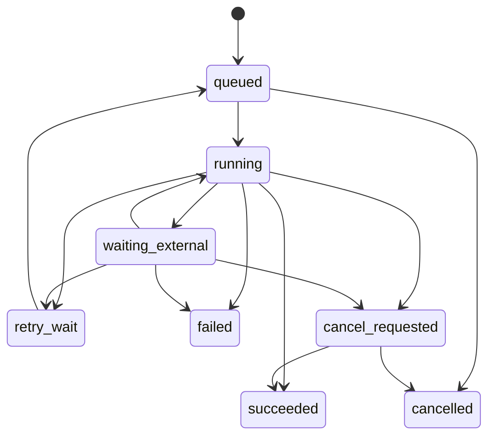

# Scanfony: MCP-powered acquisition and outcomes

Status: **Design proposal**, 2026-11-01. This document describes the next evolution
of PriceIt, not a list of capabilities already shipped. Keep one Symfony repository
and one installable PWA, with the built-in tools available by default and additional
MCP servers connected when needed. Scanfony is the acquisition experience; PriceIt
remains the first domain application and the repository name.

## Product flow

**Add server → synchronize advertised tools → select outcome environment → acquire
evidence → execute → persist results → notify and review.** The built-in server is
preconfigured, so the first capture does not require an external server.

An outcome environment supplies the context for capture, the expected result, and
the selected tool. It is not another workflow language. The user chooses what they
want to accomplish before collecting evidence, then takes several photos, records
voice notes, and answers relevant multiple-choice questions. Classification can
suggest another view or question as each image arrives. Users can finish capture,
close the PWA, and return to a durable result after synchronous, queued, or provider
batch processing.

| Environment | Evidence and questions | Expected result |
|---|---|---|
| Garage Sale Price | Overall/detail/mark photos, spoken history, condition, currency | Identification, suggested description and price, uncertainty and supporting evidence |
| Medical Equipment | Device/label/serial photos, condition, inventory location | Equipment identity, catalog fields, proposed inventory label; no clinical diagnosis or default price |
| Museum Identification | Multiple views, dimensions, maker marks, provenance notes | Candidate matches, source references, confidence and catalog draft |
| OCR document | Ordered page images, language, document type | Page-associated text and structured fields with source-image references |
| Handwriting | Ordered pages/detail crops, language and transcription preferences | Transcription, uncertain spans and page references |

Multiple-choice controls come from supported schema enums and presentation hints;
include an explicit unknown choice when the domain allows it. Never invent answers
to satisfy a required field. Each outcome can combine AI, deterministic PHP services,
and remote MCP calls; an agent is optional when the selected tool already performs
the complete task.

## Existing foundation and proposed changes

The implementation inspected for this proposal is commit `c6fe5a0`.

| Existing component | Reuse and proposed extension |
|---|---|
| [CameraBundle](../src/CameraBundle) and [ItemCaptureHandler](../src/Service/ItemCaptureHandler.php) | Preserve `CaptureHandlerInterface` and the domain-independent upload boundary. Introduce a session-aware host handler rather than teaching the bundle about MCP or inventory. |
| [CaptureQueue](../src/CameraBundle/assets/capture_queue.js) | Retain Dexie outbox, recovery, and S3/multipart upload paths. Extend capture metadata with session, revision, asset IDs and outcome selection. Do not add a competing Workbox upload queue. |
| [Item](../src/Entity/Item.php), [Media](../src/Entity/Media.php), [CaptureProfile](../src/Profile/CaptureProfile.php) | Preserve existing inventory and GarageSale/Resale/MedicalEquipment behavior. Add general acquisition/execution records; OCR results should not require fake inventory items. |
| [PricingSuggestionService](../src/Service/PricingSuggestionService.php) | Reuse the Symfony AI platform integration, structured output handling and failure checks. Its current three-image selection is a pricing limitation, not a general session limit. |
| [ItemFlow](../src/Workflow/ItemFlow.php), [ItemWorkflow](../src/Workflow/ItemWorkflow.php), [generated workflow docs](workflow/item.md) | Keep inventory lifecycle (`new`, `suggested`, `priced`, `tagged`, `failed`) separate from processing state. Existing suggest/list queues provide the async foundation. |
| [Security configuration](../config/packages/security.yaml) | Existing login and verified-user checks are a starting point. Add explicit ownership and API/MCP authorization before exposing general server connections or sensitive evidence. |
| [Composer dependencies](../composer.json) | Symfony AI platform/Anthropic, Doctrine, API Platform, Messenger, Workflow, Serializer and Validator are present. MCP client/server and AI agent bridge integration are new work. |

The [README](../README.md) describes the original capture architecture; its “No
login yet” and SQLite-only framing are historical. The
[operational handoff](../HANDOFF-2026-08-25.md) documents a Postgres deployment,
object storage, worker processes, and migration debt. This proposal does not assume
that adding a design document fixes those discrepancies or supplies migrations.

## One repository, explicit boundaries

Web and worker processes share the application's code, database and private asset
storage. They are deployment processes, not separate repositories. Keep the existing
Framework7/AssetMapper mobile frontend and Tabler review frontend. Add application
services under `src/Service`, DTOs under `src/Dto`, entities under `src/Entity`, and
execution workflows under `src/Workflow`; introduce MCP adapters under `src/Mcp`.
These are proposed locations, not scaffolding created by this document. Keep
`src/CameraBundle` reusable and `docs/workflow` generated.

## Tool definitions, DTOs and the MCP boundary

There is **no bespoke YAML task manifest and no hand-maintained copy of remote tool
definitions**. Normal Symfony service/package configuration may remain YAML under
existing conventions. The prohibition is against introducing a second task/schema
language beside PHP types and the upstream MCP contracts.

- Reuse Symfony AI message, content, tool and result DTOs at AI boundaries and the
  PHP MCP SDK's protocol DTOs at MCP boundaries. Use application DTOs only for
  Scanfony-specific acquisition, execution and completion records. Do not re-create
  Symfony AI's tool/model API in application classes.
- `Symfony\AI\Agent\Toolbox\Attribute\AsTool` registers a local callable with an
  AI agent. It is not a remote discovery mechanism.
- `Mcp\Capability\Attribute\McpTool` exposes a callable to MCP clients. Built-in
  public outcomes use this boundary and delegate to the same typed application
  services used by the PWA. Derive published schemas through the supported SDK
  reflection/schema facilities, with validation at the service boundary.
- Remote tools are discovered with `tools/list` and called with `tools/call`.
  When an agent needs them, use the Symfony AI MCP bridge rather than writing one
  `#[AsTool]` wrapper per discovered tool. A deterministic outcome can use the MCP
  client directly, without involving an agent.
- Local execution calls the service layer directly, without HTTP loopback, child
  `mcp:server` processes, or an invented in-process MCP transport. The local catalog
  reads the registered MCP definitions; it does not maintain a second schema list.

For the MVP, separate public outcome tools (`#[McpTool]`) from internal agent
primitives (`#[AsTool]`). For example, a public garage-sale outcome delegates to the
pricing service, whose agent may use a local comparable-search primitive. Do not
register that same public outcome again as an agent tool or allow it to invoke
itself recursively. The two attributes are distinct registration systems, not an
automatic schema-sharing feature. If a later feature requires the identical callable
in both, resolve shared metadata generation and schema-parity tests explicitly;
do not silently copy descriptions/constraints or claim upstream solves this case.

### Upstream decisions

Checked on 2026-11-01:

- [Issue #2003 — remote tools in the Agent Toolbox](https://github.com/symfony/ai/issues/2003)
  requested discovery without per-tool wrappers and is closed as completed.
- [PR #2497 — MCP client bridge](https://github.com/symfony/ai/pull/2497), merged
  2026-09-16, adds `symfony/ai-mcp-tool`, `McpToolbox`, `ClientToolset` and
  `ToolsetInterface`, with bundle `mcp_server` integration. It converts advertised
  schemas into agent tool metadata and forwards calls to the originating server.
  Tool prefixes address collisions; refreshed lists in long-lived processes were
  explicitly tracked separately in the PR, so verify installed-version behavior.
- [Issue #2539 — own application's MCP tools in-process](https://github.com/symfony/ai/issues/2539)
  was closed after discussion favoring direct service reuse. It does not establish
  an approved automatic `McpTool`-to-`AsTool` bridge for local services.

At implementation time, select compatible released versions of the MCP SDK/bundle,
AI agent/bundle and bridge against the existing platform dependencies and PHP/Symfony
constraints. Record the resolved versions in `composer.lock`; do not assume the
merge date means the currently installed packages contain all these APIs. This
proposal intentionally leaves dependencies unchanged.

## Server onboarding and catalog synchronization

1. An authorized user adds a named HTTPS endpoint and an authentication reference.
   Credentials remain on the Symfony server. The built-in connection is available
   without user-supplied credentials or an external dependency.
2. Initialize the MCP connection and record negotiated capabilities. Fetch every
   page of `tools/list`, preserving input schema, optional output schema,
   annotations and metadata. Resources/prompts are separate capabilities, not tools.
3. Build a versioned catalog snapshot keyed by connection ID plus original tool
   name. Use a stable, collision-checked alias when composing an agent toolbox;
   preserve the original name for the actual remote call.
4. Present only authorized, supported outcomes. Sync does not execute tools or grant
   permission to call every advertised tool. A tool without capture semantics can
   be shown as unavailable for guided acquisition or as a supported generic form.
5. Refresh manually, on supported list-change notifications, and by a bounded TTL.
   Swap snapshots atomically after a successful full fetch. On failure retain the
   last snapshot visibly marked stale; do not silently erase tools or switch servers.
   Recreate/refresh worker toolboxes as required by the installed bridge version.

MCP `tools/list` is not a portable workflow marketplace. An advertised MCP protocol
“task,” if supported by both peers, is also distinct from a Scanfony outcome and its
durable execution. Do not assume every server supports asynchronous tasks,
acquisition hints, batch processing, or webhooks.

For built-in tools, expose optional acquisition/display metadata from typed PHP
objects through supported MCP metadata or a linked resource; an optional read-only
HTTP projection can serve the same objects to the PWA. The small, versioned
**Scanfony extension** describes media roles/order, questions, result renderer,
allowed execution modes, and completion support. It references the authoritative
tool/schema; it does not repeat names, descriptions, or input constraints. This
extension is an application convention, not a standard MCP capability.

For third-party tools, preserve advertised extension metadata when available. Saved
local presets may select a tool and label its UI, but may not override its schema.
If acquisition-to-argument mapping is not advertised or structurally compatible,
require an explicit typed adapter; never guess by sending private images to an
arbitrary tool. Pin the catalog/schema hash in each acquisition session. Before
submission, validate against that snapshot and verify the tool is still authorized
and compatible. A changed/removed tool requires user review, not silent rebinding.

## Acquisition and optional per-image analysis

Create a session before capture with a client UUID, selected outcome and catalog
revision. Cache permitted outcome metadata for offline capture; syncing servers and
executing remote tools require connectivity. Store each photo/audio note with its
own client UUID, order and role (overall view, maker mark, page, detail). Keep answers
as typed values with question identifiers and schema revision. Existing single-audio
capture remains compatible; multiple voice notes are an extension to its UI/DTO.

Upload assets independently where possible, then submit the selected session
revision atomically. Scope idempotency to the owner/session and verify media size,
checksum and upload completion before considering evidence ready. Preserve the
existing whole-capture endpoint for older clients. A session-aware host adapter can
import its `photos[]`, optional `audio` and metadata into the same model.

On each available image, optionally enqueue Jev/Clef classification through a typed
adapter. Record engine/version, input checksum, category suggestions, confidence and
processing status. This is new integration work, not an installed capability implied
by the existing pricing service. Classifier failures must not discard the upload or
block capture. Low-confidence results lead to a suggestion or question, not an
automatic fact. An offline image is classified after upload. Late responses are
attached to the correct asset/revision and cannot overwrite newer answers.

Transcribe voice notes server-side when the outcome needs text, retaining the
original recording and editable transcript. Freeze the evidence and answers used by
an execution. Later corrections create a new session revision and explicit rerun;
they do not mutate an in-flight job. Keep the full evidence set even if a particular
provider adapter must select, resize or chunk images under a documented budget.

## Proposed persistence model

Use Doctrine entities and migrations; identifiers exposed to clients should be opaque.
All records belong to an owner/workspace even while the demo uses a single workspace.

| Record | Fields and relationships |
|---|---|
| `ServerConnection` | Owner, alias, endpoint, transport, encrypted credential reference, capabilities, enabled flag, last successful sync/error. Built-in is a distinguished local connection. |
| `ToolSnapshot` | Connection, original tool name, revision/hash, advertised schemas/metadata, sync timestamp. Immutable snapshots support replay/audit; not independently editable definitions. |
| `OutcomePreset` | Owner, snapshot/tool reference, display preferences and approved adapter reference; no duplicate tool schema. |
| `AcquisitionSession` | Owner, client UUID, outcome/snapshot, revision, capture state, timestamps. Unique owner + client UUID. |
| `AcquisitionAsset` | Session, client UUID, kind, role, ordinal, private storage key, MIME/size/checksum, upload state, optional existing `Media` link. Unique session + client UUID. |
| `AcquisitionAnswer` | Session revision, question key, typed value, source (user or accepted suggestion), update time. |
| `AssetAnalysis` | Asset checksum, engine/model version, state, structured classification/transcription, confidence, error; unique analysis request key. |
| `Execution` | Session revision, tool snapshot, mode, state, idempotency key, input hash, attempt/lease, deadline, provider job/task ID, progress, sanitized error, timestamps. |
| `ExecutionResult` | Execution, output schema revision, structured payload, text/resource content, provenance, model/tool versions and review status. Preserve successful result versions. |
| `CompletionSubscription` | Owner, approved HTTPS destination, secret reference/key ID, event filter, enabled flag; execution references the chosen subscription IDs. |
| `CompletionEvent` / `WebhookDelivery` | Durable event ID and execution reference; per-subscription attempts, next retry, status and response summary. Unique event + subscription. |

Persist application result DTOs using Serializer with explicit versions; do not
serialize live SDK clients or PHP objects into jobs. Queue IDs, then load authorized
records in handlers. A pricing-result projector updates/links the existing `Item`
and its `Media`; OCR/handwriting results remain session results. Preserve human-entered
prices and edits. Track inventory approval separately from execution success.

## Execution lifecycle and reliability

Acquisition states: `draft → ready → submitted`, with `abandoned` available before
submission. “Ready” means required answers and assets are validated, not merely that
the browser finished collecting them. Upload and analysis states are independent.

Execution states:

`queued` is a durable accepted job; `running` holds a bounded worker lease;
`waiting_external` holds a provider batch/MCP task identifier and next reconciliation
time. `retry_wait` is a scheduled transient retry. `failed`, `succeeded`, and
`cancelled` are terminal. Expired deadlines become `failed` with a timeout reason.
Cancellation is best effort: success may win the race before external cancellation
is confirmed. Never describe an unconfirmed remote cancellation as completed.

- **Synchronous:** persist the execution first, run the same coordinator inline
  within a short budget, and return the persisted result when complete. If unfinished,
  hand off a recoverable execution and return `202` with its status URL. Never restart
  a remote side effect just because the HTTP request timed out.
- **Async:** return `202` after durable acceptance; Messenger workers invoke the
  same coordinator. Use an execution-specific workflow, not extra meanings for
  `Item`'s inventory marking. Lease/compare-and-swap guards prevent concurrent
  workers from applying the same transition.
- **Batch:** submit once, persist the external ID and per-input correlation IDs,
  then reconcile through bounded polling or authenticated provider callbacks.
  Release the worker while waiting. Aggregate per-image successes/errors; required
  evidence failures fail the execution, while explicitly optional omissions appear
  as warnings in a successful result. Never silently label a partial required result
  complete. A simulated batch adapter must be clearly labeled in the demo.

Use an owner-scoped idempotency key plus input hash for submission. Replaying the
same request returns its execution; reusing the key with different input returns
`409`. Use transactional job/outbox persistence to close the database/dispatch gap.
Workers are at-least-once, with bounded exponential retry and jitter, failure queues,
and operator-visible errors. Invalid input, permission denial, refusal and permanent
schema incompatibility do not become endless retries.

For remote calls with unknown outcomes, reconcile using their idempotency/status
contract before retrying; if none exists, surface an indeterminate failure for review.
An unreachable server must not yield a successful empty result, even if the AI bridge
omits its tools from a listing. Required tools are checked before starting an outcome.
Only confirmed, validated completion writes the result and terminal event in one
transaction. Downstream label printing, marketplace publication and Quickbase writes
remain explicit authorized actions with their own idempotency and audit trail.

## Proposed endpoint plan

Paths below are application API proposals, except the existing capture endpoint.
Implement with Symfony controllers/API Platform DTO processors according to the
existing code. `/mcp` carries MCP JSON-RPC methods; REST paths are not MCP methods.

| Method and path | Contract |
|---|---|
| `POST /api/scanfony/servers` | Authorize and register endpoint/credential reference; return connection ID. |
| `POST /api/scanfony/servers/{id}/sync` | Refresh authorized catalog; return snapshot or queued sync reference. |
| `GET /api/scanfony/outcomes` | Authorized catalog projections with revision, availability and supported capture hints. |
| `GET /api/scanfony/outcomes/{id}` | Exact snapshot and authoritative input/output shapes, with cache revision. |
| `POST /api/scanfony/sessions` | Create or replay client session UUID and selected snapshot. |
| `POST /api/scanfony/sessions/{id}/assets` | Multipart upload or initiate short-lived, constrained private-object upload. |
| `POST /api/scanfony/sessions/{id}/assets/{assetId}/complete` | Verify uploaded object and checksum; enqueue optional analysis once. |
| `PATCH /api/scanfony/sessions/{id}` | Update ordered assets/answers using expected revision; stale updates return `409`. |
| `POST /api/scanfony/sessions/{id}/executions` | Validate/freeze revision; accept idempotency key, execution preference and approved completion subscription IDs; `201` if completed inline, otherwise `202` with `Location`. |
| `GET /api/scanfony/executions/{id}` | Durable state, progress, errors and authorized result reference; polling/ETag baseline. |
| `GET /api/scanfony/executions/{id}/result` | Stored result after completion; expose no raw credential/private storage keys. |
| `POST /api/scanfony/executions/{id}/cancel` | Request best-effort cancellation; report actual state. |
| `POST /api/scanfony/completion-subscriptions` | Register/verify destination and issue a signing secret through a protected channel. |
| `POST /api/scanfony/provider-callbacks/{provider}` | Authenticate provider callback, deduplicate and reconcile stored external job ID. |
| `POST /mcp` | Built-in authenticated MCP endpoint: discover/call public outcome tools through shared coordinator. Additional transport methods follow the SDK's negotiated HTTP support. |
| `POST /api/camera/capture` | Existing compatibility endpoint; retain old clients while adding session-aware host handling. |

Expose public outcome input/output shapes from the same registered definitions used
by MCP. Long-running built-in calls return a typed execution receipt with status/result
references rather than pretending processing finished. Native MCP task support is an
optional negotiated enhancement. “Completion subscription IDs” are a Scanfony tool
input/metadata convention; arbitrary remote tools cannot be assumed to accept them.

## Completion delivery

Persist the result, terminal state and `CompletionEvent` together, then deliver
notifications independently. Polling restores the PWA after reconnect/relaunch;
SSE/Mercure or opt-in Web Push can improve immediacy later. A push or SSE event is
only a hint to fetch the authorized execution. Do not rely on a closed PWA running
background JavaScript, and do not put sensitive result content into push payloads.

An outgoing webhook contains a version, stable event ID, event type
(`execution.succeeded`, `execution.failed`, or `execution.cancelled`), execution ID,
completion timestamp and authenticated result URL. Full result payload delivery is
opt-in and minimized. Advertise completion support with built-in tools and bind an
approved subscription at submission, including for batch jobs.

Sign the exact UTF-8 request body with HMAC-SHA-256 over
`timestamp + "." + eventId + "." + rawBody`. Send timestamp, event ID, key ID and
versioned signature headers. Receivers check freshness (for example five minutes),
compare signatures in constant time, and deduplicate by event ID. Re-sign each retry
with a fresh delivery timestamp while preserving the event ID and completion time.
Rotate per-subscription secrets with a bounded overlap and never log them.

Deliver at least once with short HTTP timeouts, exponential backoff/jitter and a
finite retry limit. Treat `2xx` as acknowledged, retry transient network/`429`/`5xx`
failures, and surface permanent failures/dead letters for authorized replay. Webhook
failure does not roll back an AI result or rerun the model. Incoming provider callbacks
use that provider's verified contract, not an assumption that they use our signature
format. Duplicate/out-of-order callbacks cannot regress terminal state.

## Authentication, safety and data handling

- Require ownership checks for connections, catalog views, sessions, assets, jobs,
  results and subscriptions. Existing browser login is not API authorization. Use
  CSRF protection for cookie-authenticated mutations and scoped service credentials
  or supported OAuth for MCP/API integrations; never expose model/server tokens to JS.
- Enforce HTTPS and outbound endpoint policy for MCP servers, callback destinations
  and remote assets. Block loopback/private/link-local/metadata addresses after DNS
  resolution and on each redirect; use controlled allowlists for explicitly trusted
  private integrations. User-added servers cannot launch arbitrary STDIO commands.
- Store evidence privately with short-lived scoped access URLs only when required.
  Validate content type, byte/pixel limits and decodeability; quarantine untrusted
  uploads, normalize unsafe metadata, and restrict downloads. Existing HTTPS-only
  URL checks are not a complete SSRF defense.
- Treat remote descriptions/results, images, OCR and voice content as untrusted data,
  including prompt injection. Restrict agent tools and egress to the selected outcome;
  tool annotations are hints, not authorization. Require explicit approval for printing,
  inventory publication, marketplace listing and other external side effects.
- Make provider/server destinations visible before evidence is sent. Medical-equipment
  photos may contain personal information: support redaction and deletion, minimize
  retention, and keep identification separate from clinical advice. Configure retention
  for originals, transcripts, results, offline caches and provider-held copies.
- Apply per-owner upload/concurrency/cost quotas, image/token budgets, deadlines and
  rate limits. Log correlation IDs, transitions and tool versions without credentials
  or unrestricted media/transcripts. Explain uncertainty and keep a human review step.
- On logout/workspace change, clear or segregate private cached results and pending
  captures. Offline capture never grants permission to execute under another account.

## Hackathon MVP and implementation sequence

The deliverable is one runnable repository with web and worker setup, documented
credentials, migrations, sample evidence, and an end-to-end demonstration. This
proposal does not assert a submission deadline or licensing eligibility; confirm
those separately, including the current Composer `proprietary` license declaration.

1. **Foundation:** add session/asset/execution/result/outbox entities and safe
   migrations; protect new APIs and private evidence. Verify fresh database setup
   and the deployed Postgres path rather than repeating the handoff's schema-update
   workaround. Preserve existing PriceIt capture and review behavior.
2. **Built-in vertical slice:** expose Garage Sale Price via `#[McpTool]`, select it
   from the default catalog, capture multiple photos plus voice and a condition
   answer, and run the existing AI service through the coordinator. Persist/link the
   result to an Item without replacing user edits.
3. **Remote discovery:** add one authenticated test MCP server, synchronize its tool
   schema, execute a compatible OCR outcome, and demonstrate that a changed schema
   needs revalidation. Reuse the upstream bridge when an agent invokes remote tools.
4. **Durable completion:** show both inline and queued processing, browser-close
   recovery, signed webhook delivery/retry, and a batch adapter contract. A fake
   provider can test delayed batch completion; real provider batch integration is a
   stretch goal and must not be described as delivered by that test.
5. **Acquisition assistance:** demonstrate one optional Jev/Clef image classifier if
   available; the no-classifier path must still work. Add the other environment
   adapters incrementally using the same acquisition model.

The UI may describe all five target environments, but only enabled, working adapters
can be selected as executable. Medical Equipment can reuse the existing profile;
Museum Identification and Handwriting need explicit adapters/results before being
presented as working. Keep arbitrary workflow composition, unrestricted server
execution, native mobile wrappers, and automatic publication out of the MVP.

## Acceptance criteria

- [ ] A fresh clone runs the PWA, built-in server and worker from this repository
      using documented setup and migrations; no second application repository is required.
- [ ] The default Garage Sale Price outcome works without adding an external server;
      an independent MCP client can discover and invoke its public tool.
- [ ] Adding a remote server and syncing discovers its real names/schemas without
      per-tool PHP wrappers or a bespoke YAML task file. Colliding names remain distinct.
- [ ] A stale, unreachable, unauthorized or changed tool produces a visible actionable
      state; it cannot silently switch targets or produce a successful empty result.
- [ ] One session retains at least three photos, voice input and a multiple-choice
      answer through offline capture, reload and resumed upload. Duplicate uploads or
      submissions create one logical asset/execution; input mismatch returns `409`.
- [ ] Per-image analysis is associated with the correct image/version; an unavailable
      classifier or late response does not lose evidence or overwrite user answers.
- [ ] Local and remote outcome boundaries use their appropriate DTOs/attributes;
      no local service calls its own MCP transport and no copied remote schema is edited.
- [ ] Inline and Messenger execution use the same result contract. A closed PWA can
      later retrieve its persisted result and failures. An expired worker lease recovers.
- [ ] Delayed batch completion is correlated once, including duplicate/out-of-order
      callbacks, partial required failures, timeout, and cancellation races. Demo fixtures
      are clearly identified if the real provider batch adapter is not included.
- [ ] Result and completion event are committed atomically. A failing webhook retries
      independently; signature tampering/stale timestamps are rejected by the example
      receiver and repeated delivery is deduplicated without repeating AI work.
- [ ] Cross-owner access, CSRF, private-network destinations, oversize uploads and
      unauthorized side effects are rejected; secrets are absent from catalog/client data.
- [ ] Existing capture, pricing and inventory transitions still work, preserve human
      edits, and do not confuse AI completion with approval or external publication.

Validate implementation with focused DTO/schema contract tests, mocked MCP/AI and
batch adapters, Messenger restart/idempotency tests, webhook receiver tests, and a
real-browser offline/reconnect demonstration. Extend the existing mocked AI tests
rather than spending API credits in the default suite. The present change is
**documentation only**; these criteria are the implementation checklist.
